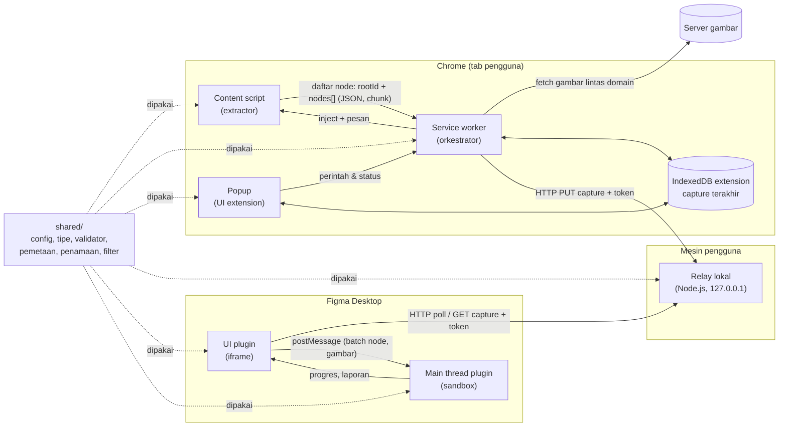
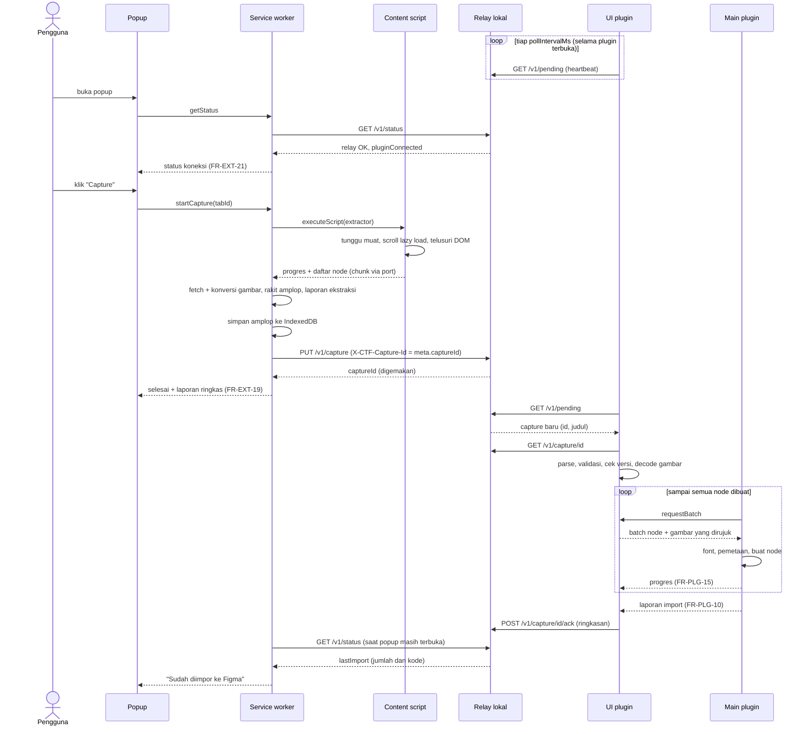

# CodeToFrame — Architecture

| | |
|---|---|
| Pemilik | Indra Pramudya |
| Status | Draft |
| Versi | 0.1.2 |
| Tanggal | 2026-10-13 |
| Dokumen terkait | `docs/PRD.md` v0.5 (acuan utama), `docs/SCHEMA.md` v0.1.1 |

Label yang dipakai:
- **[PERLU VERIFIKASI]**: fakta platform (Chrome/Figma) yang belum terkonfirmasi dari dokumentasi resmi. Setiap label punya spike di bagian 11.
- **[ASUMSI]**: keputusan sementara yang belum dikonfirmasi pemilik.
- **AD-xx**: catatan keputusan arsitektur (ringkasan di bagian 13).

Sumber dokumentasi yang dipakai untuk verifikasi (diakses 2026-10-13):
- [Figma — Plugin manifest](https://developers.figma.com/docs/plugins/manifest/) (networkAccess, `devAllowedDomains`, `main`/`ui`, `documentAccess`)
- [Figma — How plugins run](https://developers.figma.com/docs/plugins/how-plugins-run/) (sandbox vs iframe, ES2020+, `closePlugin`)
- [Figma — `figma.createImage`](https://developers.figma.com/docs/plugins/api/properties/figma-createimage/) (PNG/JPEG/GIF, maks. 4096 px)
- [Chrome — Message passing](https://developer.chrome.com/docs/extensions/develop/concepts/messaging) (serialisasi JSON, maks. 64 MiB per pesan)
- [Chrome — Service worker lifecycle](https://developer.chrome.com/docs/extensions/develop/concepts/service-workers/lifecycle) (idle 30 dtk, fetch > 30 dtk menghentikan worker)
- [Chrome — Cross-origin network requests](https://developer.chrome.com/docs/extensions/develop/concepts/network-requests) (content script terikat same-origin; service worker + host permissions bebas lintas origin)

---

## 1. Tujuan dan ruang lingkup

Dokumen ini menerjemahkan PRD menjadi rancangan teknis: komponen, batas tanggung jawab, alur data, keputusan beserta alasannya, nilai konfigurasi awal, strategi uji, dan spike. Dokumen ini menjadi acuan kerja untuk implementasi (termasuk oleh AI agent).

**Sengaja tidak dibahas di sini:**
- Rincian field data (nama field, tipe, enum) → `docs/SCHEMA.md`. Bagian 6 hanya memuat prinsip kontrak dan daftar hal yang harus diputuskan SCHEMA.
- Tabel pemetaan CSS → Figma per properti → dokumen pemetaan terpisah (mis. `docs/MAPPING.md`). Bagian 7 hanya menjelaskan mekanismenya.
- Urutan kerja dan pembagian fase → ROADMAP (terpisah). Fase tetap mengikuti PRD bagian 5 dan 9.2.

## 2. Gambaran arsitektur



### 2.1 Komponen dan batas tanggung jawab (AD-01)

| Komponen | Berjalan di | Hak/izin | Tanggung jawab | TIDAK boleh |
|---|---|---|---|---|
| **Content script** (`extension/src/content`) | Tab halaman, di-inject on demand lewat `chrome.scripting.executeScript` | Akses DOM halaman; fetch terikat same-origin halaman | Menunggu/scroll lazy load, menelusuri DOM, filter keterlihatan, mengambil rect dan computed style, mengumpulkan daftar URL gambar, menyerialisasi daftar node (`rootId` + `nodes[]`) | Menulis clipboard; mengambil gambar lintas domain; bicara ke relay; menyimpan data; memetakan ke nilai Figma |
| **Service worker** (`extension/src/background`) | Proses extension (MV3) | `scripting`, `storage`, `host_permissions: ["<all_urls>"]` | Orkestrasi capture, status progres, fetch dan konversi gambar, merakit amplop data, simpan ke IndexedDB, kirim ke relay, cek status koneksi | Akses DOM; clipboard; menampilkan UI; menerima perintah fetch URL bebas dari content script (hanya URL gambar yang tercatat di daftar node) |
| **Popup** (`extension/src/popup`) | Halaman extension, punya fokus dokumen saat terbuka | Sama dengan origin extension | Tombol Capture, status koneksi (FR-EXT-21), progres (FR-EXT-13), laporan ringkas (FR-EXT-19), Download (FR-EXT-11), Copy (FR-EXT-12), pengaturan token pairing | Menjalankan capture (popup bisa tertutup kapan saja); menyimpan state penting di memorinya sendiri |
| **Relay lokal** (`relay/`) | Proses Node.js di terminal pengguna | Listen hanya di loopback | Menerima capture dari extension, menyimpan satu capture terakhir di memori, menyajikannya ke plugin, melacak heartbeat plugin | Menyimpan ke disk (kecuali file token); mencatat isi capture di log; menerima koneksi non-loopback; memproses/mengubah isi capture |
| **UI plugin** (`plugin/src/ui`) | Iframe Figma (`figma.showUI`), punya akses API browser | `networkAccess.devAllowedDomains` ke relay | Polling relay, meminta token pairing ke main thread lewat pesan (karena `figma.clientStorage` diakses dari main thread **[PERLU VERIFIKASI]**, SP-01), upload/drag-drop/tempel (FR-PLG-02), parse + validasi + cek versi, decode gambar, menyuplai batch ke main thread, menampilkan progres dan laporan | Mengakses scene Figma; memetakan CSS ke Figma |
| **Main thread plugin** (`plugin/src/main`) | Sandbox Figma (tanpa API browser, ES2020+) | Scene API Figma, `documentAccess: "dynamic-page"` | Pemuatan font + fallback, pembuatan node, penerapan hasil pemetaan, verifikasi Auto Layout (v2), menyusun laporan import | Network; parsing JSON mentah dari luar tanpa validasi; logika pemetaan sendiri di luar modul `shared/mapping` |
| **shared** (`shared/`) | Di-bundle ke semua komponen | — | Tipe data, konstanta konfigurasi, validator, pemetaan CSS→Figma, penamaan layer, aturan filter keterlihatan, pencocokan font, simulasi Auto Layout | Bergantung pada API Chrome, Figma, Node, atau DOM (harus murni agar bisa diuji unit) |

Pelajaran versi lama yang dikunci di batas ini:
- **Clipboard** hanya ditulis dari popup, satu-satunya konteks yang punya fokus dokumen saat pengguna mengklik "Copy" (mengatasi "Document is not focused").
- **Pemetaan nilai CSS → enum Figma** hanya ada di `shared/mapping`. Main thread memanggil fungsinya dan tidak pernah memakai string CSS langsung sebagai nilai properti Figma.

## 3. Keputusan transfer langsung (AD-02)

### 3.1 Konteks

FR-EXT-10 menuntut transfer tanpa salin-tempel; K1-07 menuntut maksimal 1 klik per capture setelah penyiapan awal dan dengan plugin terbuka. Fakta platform:
- Main thread plugin tidak punya `fetch`/network; hanya iframe UI yang punya (Figma, "How plugins run").
- Iframe UI boleh menghubungi domain yang dideklarasikan di manifest; localhost dengan port didukung, dan untuk server pengembangan dianjurkan memakai `devAllowedDomains` (Figma, "Plugin manifest").
- Plugin tidak bisa dijalankan dari luar Figma dan hanya aktif selama dibuka (A7; dikonfirmasi sebagian oleh dokumentasi `closePlugin`, sisanya **[PERLU VERIFIKASI]**, spike SP-02).
- Service worker extension dengan host permissions dapat melakukan fetch lintas origin (Chrome, "Cross-origin network requests").

Jadi harus ada titik temu yang bisa dijangkau extension **dan** iframe plugin. Plugin tidak bisa menjadi server, sehingga plugin harus menarik (pull) data.

### 3.2 Opsi

| Opsi | Ringkasan | Status | Alasan |
|---|---|---|---|
| A. **Relay HTTP lokal, plugin polling** | Proses Node.js di `127.0.0.1`. Extension `PUT` capture; UI plugin polling metadata lalu `GET` isi | **Dipilih** | Hanya butuh `node:http` (nol dependensi). Polling sekaligus berfungsi sebagai heartbeat untuk FR-EXT-21. Mudah diuji dengan `curl` |
| B. Relay lokal dengan WebSocket | Sama dengan A, tetapi push via WebSocket | Ditolak untuk v1 | Server WebSocket di Node butuh dependensi atau implementasi protokol sendiri. Keuntungan latensi (< 1 dtk) tidak penting untuk alur 1 klik. Bisa ditinjau ulang bila polling terbukti bermasalah |
| C. UI plugin dimuat dari relay | Iframe plugin menavigasi ke `http://localhost:PORT/ui`, sehingga satu origin dengan relay | Cadangan bila A gagal di SP-01 | Menghindari CORS, tetapi UI plugin bergantung pada relay menyala dan alur pesan iframe ↔ main lebih rumit **[PERLU VERIFIKASI]** |
| D. Native messaging host | Extension ↔ aplikasi native lewat `connectNative` | Ditolak | Plugin tetap butuh jalur network, jadi tetap perlu server lokal. Menambah registrasi host di OS (registry Windows), sehingga penyiapan lebih berat (NFR-06) |
| E. Server hosted (cloud relay) | Extension dan plugin bertemu di server publik | Ditolak | Data halaman (termasuk di balik login) keluar dari mesin pengguna, bertentangan dengan NFR-03 dan prinsip 4. Butuh operasional server |
| F. Clipboard otomatis | Extension menyalin, plugin membaca clipboard saat dibuka | Ditolak | Membaca clipboard dari iframe plugin tetap butuh aksi tempel/izin. Itu langkah manual kedua (K1-07) |
| G. Content script di tab figma.com | Extension menyuntik ke Figma web untuk berbicara dengan plugin | Ditolak | Hanya berlaku untuk Figma di browser; PRD menetapkan Figma Desktop (NFR-05) |
| H. Folder bersama / file watcher | Extension menulis file, plugin membaca | Ditolak | Plugin tidak punya akses file system; extension hanya bisa menulis lewat Downloads |

### 3.3 Keputusan

Opsi A: **relay HTTP lokal (Node.js, tanpa dependensi runtime)**, dengan UI plugin melakukan polling. Opsi C disiapkan sebagai rencana cadangan bila spike SP-01 menunjukkan iframe plugin di Figma Desktop tidak bisa menghubungi localhost lintas origin.

**Konsekuensi:**
- Pengguna perlu Node.js (sudah dibutuhkan untuk build dari repo) dan menjalankan `npm run relay` di terminal. Ini bagian penyiapan awal (NFR-06, K1-07).
- Jalur cadangan (FR-EXT-11, FR-EXT-12, FR-PLG-02) tetap wajib dan tidak bergantung pada relay.

### 3.4 Protokol relay (sketsa)

Semua endpoint di bawah prefiks `/v1`. Semua endpoint kecuali preflight `OPTIONS` butuh header `Authorization: Bearer <token>` (bagian 3.8). Bentuk body rinci ada di SCHEMA bagian 8.

| Endpoint | Pemanggil | Fungsi |
|---|---|---|
| `OPTIONS /v1/*` (preflight CORS) | Browser, otomatis | Tidak butuh token karena preflight tidak membawa header `Authorization`. Tetap melewati pemeriksaan `Host` dan `Origin` (3.9); respons hanya berisi header CORS, tanpa data |
| `GET /v1/status` | Extension | Versi protokol relay, `pluginConnected` (heartbeat), metadata slot tanpa isi halaman (id, waktu, ukuran, versi format) dan `lastImport` (hanya jumlah dan kode) bila ada. Tidak memuat judul atau URL (SCHEMA SD-10) |
| `PUT /v1/capture` | Extension | Mengunggah amplop capture; menggantikan slot sebelumnya. `captureId` dibuat extension (`meta.captureId`, header `X-CTF-Capture-Id`) dan hanya digemakan relay; judul dikirim lewat header `X-CTF-Title` (SCHEMA 8.3) |
| `GET /v1/pending?known=<captureId>` | UI plugin, tiap `pollIntervalMs` | Heartbeat plugin + metadata capture terbaru bila berbeda dari `known`, termasuk judul (satu-satunya endpoint yang memuat judul) |
| `GET /v1/capture/<captureId>` | UI plugin | Mengunduh amplop |
| `POST /v1/capture/<captureId>/ack` | UI plugin | Melaporkan import selesai (ringkasan laporan, tanpa isi halaman); slot dikosongkan |

### 3.5 Alur pesan



Setelah `ack`, slot dikosongkan, tetapi relay menyimpan `lastImport` (hanya jumlah dan kode) sampai `PUT` berikutnya atau relay dimatikan. Dari situ popup menampilkan "Sudah diimpor ke Figma" (SCHEMA 8.4).

Popup boleh ditutup kapan saja. Capture tetap berjalan di service worker dan content script, dan status disimpan di `chrome.storage.session`, sehingga progres terlihat lagi saat popup dibuka ulang.

### 3.6 Capture terakhir sementara (AD-03)

Opsi dari FR-EXT-10 diputuskan: **ya, relay menyimpan satu capture terakhir di memori.**
- **Satu slot.** Capture baru menggantikan yang lama. Ini sederhana dan cukup untuk alur satu orang.
- **Masa hidup.** Slot dikosongkan saat (a) plugin mengirim `ack`, (b) melewati `relaySlotTtlMs`, atau (c) relay dimatikan. Tidak pernah ditulis ke disk. Setelah `ack`, relay menyimpan `lastImport` (hanya jumlah dan kode, tanpa isi halaman) sampai `PUT` berikutnya atau relay dimatikan.
- **Perilaku plugin.**
  - Bila capture baru tiba **saat plugin terbuka**, import berjalan otomatis (memenuhi K1-07).
  - Bila plugin **baru dibuka dan ada capture tertunda**, plugin menampilkan "Import capture terakhir: {judul}, {waktu}" dan menunggu klik. Judul berasal dari header `X-CTF-Title` yang dikirim extension saat `PUT` (SCHEMA 8.3, 8.5).

  Alasan: import otomatis saat plugin dibuka dapat mengejutkan pengguna yang membuka plugin untuk tujuan lain (mis. upload file), sedangkan urutan "capture dulu, buka plugin kemudian" tetap didukung dengan satu klik tambahan. Ini di luar cakupan K1-07, karena K1-07 mensyaratkan plugin sudah terbuka. Perilaku ini (import otomatis hanya bila plugin sudah terbuka; satu klik bila plugin baru dibuka dan ada capture tertunda) dikonfirmasi oleh pemilik pada 2026-10-13.
- **Di sisi extension**, amplop terakhir disimpan di IndexedDB extension (satu record, ditimpa tiap capture, dihapus saat `chrome.runtime.onStartup`). Tujuannya agar Download dan Copy tetap tersedia walaupun service worker dihentikan Chrome (idle 30 detik).

### 3.7 Status koneksi dan jalur cadangan (FR-EXT-21)

Saat popup dibuka dan tepat sebelum capture, service worker memanggil `GET /v1/status` dengan batas `statusTimeoutMs`.

| Kondisi | Tampilan popup | Perilaku capture |
|---|---|---|
| Relay tidak menjawab | "Relay tidak aktif. Jalankan `npm run relay`." + tombol Download/Copy | Capture tetap jalan; hasil disimpan di IndexedDB dan ditawarkan lewat Download/Copy |
| Token ditolak (401) | "Token pairing tidak cocok. Periksa pengaturan." | Sama dengan di atas |
| Relay aktif, plugin tidak terhubung (heartbeat lebih tua dari `pluginHeartbeatTimeoutMs`) | "Buka plugin CodeToFrame di Figma." + Download/Copy | Capture dikirim ke relay; popup menjelaskan bahwa capture menunggu di relay dan bisa diimpor saat plugin dibuka |
| Relay aktif, plugin terhubung | Indikator hijau | Alur langsung |

Jalur cadangan:
- **Download** (FR-EXT-11): popup membaca amplop dari IndexedDB, membuat `Blob`, lalu memicu `<a download>`. Tidak butuh izin `downloads`.
- **Copy** (FR-EXT-12): popup memanggil `navigator.clipboard.writeText` saat tombol diklik. Popup punya fokus dan gestur pengguna.
- **Plugin** (FR-PLG-02): menerima file lewat `<input type=file>`, drag-drop ke area UI plugin **[PERLU VERIFIKASI: drop file ke iframe plugin di Figma Desktop]**, dan tempel teks ke textarea. Ketiganya masuk ke pipeline render yang sama dengan jalur langsung, sehingga hasilnya identik (K1-08).

### 3.8 Menjalankan relay dan penyiapan awal

- **Menjalankan:** `npm run relay` (setelah `npm run build`). Relay mencetak alamat, versi protokol, dan token. Untuk mematikannya, tekan Ctrl+C atau tutup terminal. Tidak ada autostart atau service OS. Ini disengaja: relay hanya hidup saat pengguna menginginkannya, sehingga permukaan serangan lebih kecil.
- **Penyiapan awal** (sekali, ditulis di README sesuai NFR-06):
  1. `npm install && npm run build`.
  2. Chrome: `chrome://extensions` → Developer mode → Load unpacked → `extension/dist`.
  3. Figma Desktop: Plugins → Development → Import plugin from manifest → `plugin/dist/manifest.json`.
  4. `npm run relay`. Saat pertama kali jalan, relay membuat token acak dan menyimpannya di file token di folder konfigurasi pengguna.
  5. Tempel token ke pengaturan popup extension (disimpan di `chrome.storage.local`) dan ke pengaturan plugin. UI plugin mengirim token ke main thread lewat pesan, lalu main thread menyimpannya di `figma.clientStorage`. Saat plugin dibuka, UI meminta token ke main thread lewat pesan. Alasannya, `figma.clientStorage` diakses dari main thread, bukan dari iframe UI **[PERLU VERIFIKASI]**, SP-01.
- **Rotasi token:** `npm run relay -- --new-token`, lalu ulangi langkah 5.

### 3.9 Keamanan dasar (AD-04)

**Model ancaman singkat.**
- **Aset:** isi capture, yang bisa berasal dari halaman di balik login (data pribadi, token di DOM).
- **Penyerang yang relevan:**
  - (1) Situs web lain yang terbuka di browser yang sama dan mencoba membaca atau menyuntik capture lewat `http://localhost`.
  - (2) Proses lain atau host lain di jaringan lokal.
  - (3) DNS rebinding.
- **Di luar model:** malware yang sudah berjalan sebagai pengguna yang sama. Penyerang seperti ini bisa membaca memori dan file token; tidak ada pertahanan yang masuk akal di level aplikasi ini.

| Pembatasan | Alasan |
|---|---|
| Listen hanya di `127.0.0.1` dan `::1` | Menutup penyerang (2). Dua listener dipasang karena `localhost` dapat resolve ke IPv6 lebih dulu **[PERLU VERIFIKASI]** |
| Token bearer acak 128-bit di setiap request kecuali preflight `OPTIONS` (yang tidak mengembalikan data); dibandingkan secara constant-time | Penyerang (1): situs lain tidak tahu token. Juga mencegah penyuntikan capture palsu yang akan otomatis dirender di Figma |
| Cek header `Host` harus `localhost:PORT`, `127.0.0.1:PORT`, atau `[::1]:PORT` | Menutup DNS rebinding (3) |
| Allowlist `Origin`: hanya `chrome-extension://*` dan `null` (iframe plugin **[PERLU VERIFIKASI: nilai origin iframe plugin]**); origin `http(s)` situs ditolak 403 sebelum token diperiksa | Lapisan tambahan terhadap (1). `null` tetap bisa dipalsukan oleh iframe sandbox, jadi token adalah pertahanan utama |
| CORS hanya memantulkan origin yang lolos allowlist; tanpa `*` | Situs lain tidak bisa membaca respons |
| Batas ukuran body `relayMaxBodyBytes`, satu request upload sekaligus | Mencegah kehabisan memori |
| Penyimpanan hanya di memori, satu slot, ber-TTL | Data tidak tertinggal di disk (NFR-03) |
| Log hanya metadata (method, path, status, ukuran byte); tidak pernah URL halaman, judul, atau isi | Isi capture tidak bocor ke riwayat terminal atau file log |
| Respons error tidak menggemakan isi request | Mencegah kebocoran tidak langsung |

Catatan: Chrome menerapkan pembatasan akses jaringan lokal dari situs publik (Private/Local Network Access), yang menambah lapisan terhadap (1). Namun desain ini **tidak bergantung** padanya **[PERLU VERIFIKASI: dampaknya ke iframe plugin Figma Desktop, SP-01]**.

## 4. Alur data per tahap

### 4.1 Pipeline capture

| # | Tahap | Penanggung jawab | Input → Output | Perilaku saat gagal |
|---|---|---|---|---|
| C1 | Inject dan persiapan | SW | `tabId` → extractor berjalan di frame utama | Halaman terlarang (`chrome://`, Web Store) → error jelas di popup, tidak ada capture |
| C2 | Tunggu muat dan lazy load (FR-EXT-03) | CS | — → halaman siap | Tunggu `loadSettleMs`. Scroll per tinggi viewport dengan jeda `scrollStepDelayMs`, maksimal `maxScrollSteps` langkah dan total `maxWaitMs`. Lalu tunggu `document.fonts.ready` dan gambar yang sedang dimuat (dalam sisa batas waktu). Kembali ke posisi scroll 0. Batas tercapai → peringatan "dipotong pada batas scroll" di laporan, lalu lanjut |
| C3 | Penelusuran DOM | CS | `document.documentElement` (atau root lain, NFR-08) → daftar elemen terurut | Diproses per `walkBatchSize` elemen lalu yield ke event loop agar tab tidak membeku (NFR-01). Elemen dengan open shadow root: telusuri `shadowRoot` dan `<slot>` lewat `assignedNodes({flatten:true})` (FR-EXT-20, v2). Closed shadow root: hanya host-nya. `iframe`, `canvas`, `video` → node placeholder dengan jenisnya (FR-PLG-16) |
| C4 | Filter keterlihatan (FR-EXT-05) | CS memanggil `shared/visibility` | rect + style + rect clip induk → simpan / lewati (dengan alasan) | Aturan murni dan teruji unit. Hasil hitung "dilewati" per alasan masuk laporan (FR-EXT-19) |
| C5 | Pengumpulan gaya dan geometri (FR-EXT-04, -06, -07) | CS | elemen → node mentah (rect koordinat halaman = rect + `scrollX/Y`, subset computed style relevan, teks per segmen dengan run bergaya, rect gabungan via `Range.getClientRects`; SCHEMA 4.4) | `try/catch` per elemen. Elemen gagal → node minimal (rect saja) + peringatan; penelusuran lanjut (NFR-02) |
| C6 | Normalisasi | CS memanggil `shared/normalize` | node mentah → node ternormalisasi (warna ke RGBA numerik, px numerik, font-family diurai jadi daftar) | Nilai yang tidak bisa diurai disimpan sebagai string asli + peringatan; plugin memakai default aman |
| C7 | Serialisasi ke SW | CS → SW | daftar node (`rootId` + `nodes[]`) → JSON string dipotong per `messageChunkBytes` lewat port `chrome.runtime.connect` | Port putus → capture gagal dengan pesan jelas. Data parsial tidak dikirim |
| C8 | Pengambilan gambar (FR-EXT-08/09) | SW | daftar URL unik dari daftar node → aset gambar | Detail di 7.5. Per gambar: gagal/diblokir/terlalu besar → aset bertanda gagal + alasan (R8); capture lanjut |
| C9 | Perakitan amplop dan laporan ekstraksi | SW | daftar node + aset + metadata (FR-EXT-14) → amplop. `meta.url` dan `assets[].sourceUrl` ditulis tanpa query dan hash (SCHEMA SD-13) | — |
| C10 | Simpan dan kirim | SW | amplop → IndexedDB, lalu `PUT` relay | Relay gagal → capture tetap sukses lokal; popup menawarkan Download/Copy |

Catatan geometri v1: capture memakai posisi scroll 0 setelah C2, sehingga elemen `fixed`/`sticky` tercatat di posisi awal halaman. Penanganan akuratnya adalah tugas v3 (FR-EXT-17).

### 4.2 Pipeline render

| # | Tahap | Penanggung jawab | Input → Output | Perilaku saat gagal |
|---|---|---|---|---|
| R1 | Penerimaan | UI | relay / file / drop / tempel → string JSON | Error baca → pesan; tidak ada node dibuat |
| R2 | Parse, validasi, cek versi (FR-PLG-03, NFR-07) | UI memanggil `shared/validate` | string → amplop tervalidasi + daftar peringatan | Ada dua tingkat. **Fatal** (bukan JSON, bukan format CodeToFrame, major version berbeda, root hilang): tolak dengan pesan, tanpa node. **Per node** (field hilang/salah tipe): node ditandai untuk default/dilewati, lanjut (NFR-02, K1-10) |
| R3 | Decode gambar | UI | base64 → `Uint8Array` per aset (lazy, saat diminta batch) | Decode gagal → aset dianggap gagal → placeholder |
| R4 | Font (FR-PLG-05) | Main memanggil `shared/fonts` | daftar font unik di amplop + `figma.listAvailableFontsAsync()` → tabel resolusi font, lalu `loadFontAsync` per font hasil | Gagal muat → turun ke tingkat berikutnya, akhirnya Inter. Inter pun gagal → node teks dilewati + error di laporan |
| R5 | Pembuatan node | Main, pull batch dari UI (AD-07) | batch node pra-urut (induk sebelum anak) → node Figma | `try/catch` per node. Gagal → placeholder abu-abu atau dilewati + peringatan; anak ditempel ke induk terdekat yang berhasil |
| R6 | Pemetaan | Main memanggil `shared/mapping` | gaya ternormalisasi → properti Figma | Nilai tak dikenal → default aman + peringatan (FR-PLG-08, K1-09) |
| R7 | Auto Layout (v2, FR-PLG-13) | Main + `shared/autolayout` | frame + anak → Auto Layout atau tetap absolut | Lihat 7.6. Ragu → absolut |
| R8 | Laporan (FR-PLG-10) | Main → UI | akumulasi peringatan → laporan di UI + ringkasan `ack` ke relay | — |

Transaksi "tanpa node setengah jadi" (FR-PLG-03) berlaku untuk error fatal di R2, yang terjadi sebelum node apa pun dibuat. Bila error tak terduga terjadi di tengah R5, frame akar yang sudah dibuat **dibiarkan** dan diberi nama `… (tidak lengkap)`, disertai laporan error. Alasannya: menghapus hasil parsial menyembunyikan informasi diagnostik. Sesuai keputusan PRD v0.4 (P-05; PRD FR-PLG-03, 11.1 no. 20).

## 5. Ukuran data besar

| Batas | Nilai | Status | Strategi |
|---|---|---|---|
| Pesan `chrome.runtime` | 64 MiB, serialisasi JSON | Terverifikasi (Chrome, Message passing) | Daftar node dipotong per `messageChunkBytes` lewat port. Biner tidak pernah lewat pesan; gambar diambil langsung oleh SW |
| Fetch di SW | Worker dihentikan bila respons fetch > 30 dtk | Terverifikasi (Chrome, SW lifecycle) | Fetch gambar memakai `imageFetchTimeoutMs` (< 30 dtk). Upload ke relay di loopback diharapkan jauh di bawah batas ini; diukur di SP-03 |
| Idle SW | 30 dtk tanpa event | Terverifikasi | Selama capture, pesan dari CS dan panggilan API me-reset timer. Amplop disimpan di IndexedDB agar tahan restart SW |
| Ukuran gambar Figma | PNG/JPEG/GIF, maks. 4096 px per sisi | Terverifikasi (Figma, createImage) | Konversi dan downscale di SW sebelum dikirim (7.5) |
| `postMessage` UI → main | Mendukung `Uint8Array`; batas ukuran tidak diketahui | **[PERLU VERIFIKASI]** | Main menarik batch berisi `renderBatchSize` node + gambar yang dirujuk saja |
| Memori iframe dan parse JSON besar | Tidak diketahui | **[PERLU VERIFIKASI]** | Total gambar dibatasi `imageMaxTotalBytes`. Ukuran dan waktu parse amplop diukur sebagai metrik NFR-01 |
| Tempel teks di textarea | Praktis lambat untuk teks puluhan MB | **[PERLU VERIFIKASI]** | UI menyarankan Download → upload file untuk capture besar. Lihat P-03 |

**Progres:**
- **Extension** (FR-EXT-13): tahap C2 (langkah scroll *n/maks*), C3–C6 (elemen diproses), C8 (gambar *n/total*), C10 (mengirim). State disimpan di `chrome.storage.session` dan dibaca popup.
- **Plugin** (FR-PLG-15): tahap R2, R4 (font *n/total*), R5 (node *n/total*), R7.

**Metrik NFR-01** yang dicatat di laporan (ekstraksi dan import), agar ambang bisa ditetapkan setelah pengukuran:
- waktu ekstraksi per tahap;
- waktu render per tahap;
- jumlah node;
- ukuran JSON daftar node (`nodesJsonBytes`, SCHEMA 6.1);
- total byte gambar.

## 6. Prinsip kontrak data

- **Satu amplop untuk semua jalur (AD-05).** Relay, Download, Copy, dan upload memakai format yang persis sama, termasuk gambar yang tertanam sebagai base64. Akibatnya K1-08 (hasil identik) tercapai secara konstruksi, dan file `.json` mandiri. Konsekuensinya ada overhead base64 sekitar 33%, yang ikut diperhitungkan di `relayMaxBodyBytes`.
- **Bentuk umum amplop:**
  - `format` (penanda format, `"codetoframe"`);
  - `formatVersion`;
  - `meta` (FR-EXT-14: URL, judul, lebar viewport, tinggi halaman, waktu capture, plus versi extension, devicePixelRatio, deskripsi root);
  - `rootId` + `nodes` (daftar node datar berurutan preorder dengan `parentId`; SCHEMA SD-01);
  - `assets` (gambar, dirujuk dengan id dari node);
  - `report` (laporan ekstraksi FR-EXT-19 + metrik).
- **Root bebas (NFR-08).** Node root (`rootId`) adalah node elemen biasa dengan rect dalam koordinat halaman. Plugin tidak mengasumsikan `root` adalah `body`/`html`; frame akar dibuat seukuran rect root. Untuk v1–v2, root selalu `documentElement` dengan ukuran halaman penuh.
- **Versioning (NFR-07).** `formatVersion` berbentuk `MAJOR.MINOR`.
  - MAJOR berbeda → ditolak dengan pesan yang menyebut versi data dan versi yang didukung.
  - MINOR lebih baru dari yang dikenal plugin → diterima, field tak dikenal diabaikan, peringatan "data dari extension yang lebih baru".
  - Penambahan field opsional menaikkan MINOR; perubahan makna atau penghapusan field menaikkan MAJOR.
  - Versi protokol relay terpisah (prefiks `/v1`).
- **Data tidak lengkap atau rusak.** Validator di `shared` dipakai di dua tempat: oleh extension sebelum menyimpan (sebagai self-check) dan oleh plugin sebelum render. Validator membedakan error fatal dan error per node (4.2 R2). Semua field gaya bersifat opsional; ketiadaan field berarti "pakai default CSS awal".
- **Node menyimpan nilai terukur, bukan keputusan Figma.** Data hanya berisi fakta dari browser (nilai ternormalisasi). Keputusan pemetaan ke Figma dibuat di plugin. Dengan begitu, perbaikan pemetaan tidak membutuhkan capture ulang.

**Yang harus diputuskan SCHEMA.md:**
- Nama dan tipe setiap field amplop, `meta`, node, aset, dan laporan.
- Representasi warna, panjang, dan font-family terurai.
- Representasi teks: satu text node per DOM text node, atau run bergaya untuk teks inline campuran (`<p>` dengan `<b>`).
- Jenis node (elemen, teks, gambar, placeholder + jenis konten, pseudo-element v2, svg v2) dan cara menandai alasan dilewati.
- Representasi aset gambar dan status gagal + alasan.
- Format laporan dan peringatan (kode peringatan yang stabil agar bisa dihitung).
- Aturan kompatibilitas MINOR/MAJOR secara konkret dan nilai awal `formatVersion`.
- Body JSON endpoint relay (3.4).
- JSON Schema atau validator TypeScript sebagai sumber kebenaran tunggal.

## 7. Mekanisme fitur lintas komponen

### 7.1 Pemetaan defensif terpusat (FR-PLG-08, AD-08)

- Modul `shared/mapping` berisi fungsi murni per kelompok properti. Contoh: `mapFlexJustify(css) → {value, warning?}`, `mapBoxShadow(list) → Effect[]`, `mapBorder(...)`, `mapTextAlign(...)`.
- Setiap fungsi punya tiga ciri:
  1. menerima nilai yang sudah dinormalisasi;
  2. **selalu** mengembalikan nilai enum Figma yang valid, yang diketik dengan tipe dari `@figma/plugin-typings`;
  3. mengembalikan peringatan berkode bila memakai default.
- Kasus versi lama (`stretch` → `"STRETCH"`) tertutup secara struktural, karena tipe keluaran adalah union enum Figma dan TypeScript menolak string bebas.
- Tabel pemetaan rinci ada di dokumen pemetaan terpisah. Setiap baris tabel punya uji unit.
- Contoh catatan mekanisme yang relevan untuk v1:
  - `createFrame()` di Figma secara default memotong konten (clip) **[PERLU VERIFIKASI]**, sehingga pemetaan harus selalu menyetel `clipsContent` eksplisit dari `overflow` (K1-03).
  - Border memakai stroke `INSIDE` agar sesuai dengan border-box.
  - `spread` pada shadow hanya didukung untuk jenis node tertentu **[PERLU VERIFIKASI]**.

### 7.2 Strategi font (FR-PLG-05, FR-PLG-06, FR-EXT-07)

- **Di extension:** `font-family` disimpan sebagai daftar terurai. "Font yang benar-benar dipakai" hanya bisa diperkirakan, dengan cara mengambil keluarga pertama di daftar yang lolos `document.fonts.check()` atau yang berupa keluarga generik. Keterbatasan ini dicatat (P-04).
- **Di plugin** (`shared/fonts`, murni; input berupa daftar font tersedia dari `listAvailableFontsAsync`):
  1. **Cocok persis:** nama keluarga ternormalisasi (huruf kecil, tanpa tanda kutip/spasi berlebih) sama, untuk setiap keluarga dalam daftar `font-family` secara berurutan.
  2. **Padanan nama:** cocok setelah normalisasi lanjut (buang akhiran seperti "Variable", "VF", "Web", nomor versi).
  3. **Pemetaan manual kecil** untuk kasus umum (`shared/fonts/manual-map.ts`). Contoh bentuknya: font sistem → padanan yang umum tersedia. Isinya diisi dari hasil uji halaman acuan; tidak ditetapkan di sini.
  4. **Kategori:** keluarga generik (`serif`/`sans-serif`/`monospace`) atau kategori yang tercantum di pemetaan manual → font default per kategori.
  5. **Inter.**
- **Bobot dan gaya** CSS (100–900, italic) dipetakan ke nama style Figma yang tersedia untuk keluarga tersebut, dengan memilih bobot terdekat. Nama style Inter di Figma perlu dicek **[PERLU VERIFIKASI: mis. "Semi Bold" vs "SemiBold", SP-05]**.
- **Penyimpanan font asli (FR-PLG-06, AD-13):** `node.setSharedPluginData("codetoframe", "sourceFont", <JSON ringkas: family list, weight, style>)`. Shared plugin data dipilih (bukan `setPluginData`) agar dapat dibaca alat lain. Font asli juga tercantum di laporan (asli → pengganti).

### 7.3 Penamaan layer (FR-PLG-11)

- Fungsi murni `shared/naming.layerName(node)` membentuk nama dengan aturan berikut:
  - **Elemen:** `tag.classUtama`. "Class utama" adalah class pertama yang tidak tampak seperti hash buatan alat (mis. pola CSS-in-JS `css-1a2b3c`, `sc-xyz`, `_a1B2c`). Bila tidak ada class yang lolos, nama jadi `tag` saja (contoh: `div.header`).
  - **Teks:** `tag "isi"`, dengan isi dipangkas sampai `layerNameTextMaxChars` lalu diberi `…` (contoh: `h1 "Selamat datang"`).
  - **Placeholder:** `iframe [tidak didukung]`, `img [gagal: <alasan singkat>]`.
- Pola "class tampak hash" disimpan sebagai daftar regex di modul yang sama dan diuji unit.

### 7.4 Placeholder (FR-PLG-09, FR-PLG-16)

- Satu fungsi pembuat placeholder di main dipakai untuk dua kasus: gambar gagal dan konten yang tidak didukung.
- Bentuknya: frame berukuran dan berposisi asli, fill abu-abu (`placeholderFill`), stroke putus-putus, dan label teks di tengah berisi jenis konten atau alasan gagal ("iframe", "canvas", "video", "gambar: diblokir server").
- Bila label lebih besar dari kotaknya, label disembunyikan dan nama layer tetap membawa informasinya.
- Font label: Inter. Kalau Inter tidak tersedia, label dilewati.

### 7.5 Gambar lintas domain (FR-EXT-08/09, AD-06)

1. CS mencatat untuk setiap ``: `currentSrc`, ukuran natural, rect, `object-fit`/`object-position`. URL dideduplikasi.
2. SW mengambil hanya URL yang ada di daftar node (bukan URL bebas dari pesan, sesuai anjuran keamanan Chrome). Fetch memakai `credentials: "include"` agar gambar yang membutuhkan sesi ikut termuat **[PERLU VERIFIKASI: pengiriman cookie dari SW dengan host permissions, SP-09]**. Batas waktu `imageFetchTimeoutMs`. Fetch dan deduplikasi di memori memakai URL penuh; hanya nilai `assets[].sourceUrl` yang ditulis ke amplop yang dibersihkan dari query dan hash (SCHEMA SD-13).
3. URL `blob:` dan gambar same-origin yang gagal di SW diambil oleh CS (same-origin), lalu dikirim sebagai data URL lewat port yang sama dengan daftar node. `data:` didekode langsung.
4. **Konversi di SW:** format selain PNG/JPEG/GIF (WebP, AVIF, SVG) di-decode lewat `createImageBitmap` lalu di-encode ke PNG dengan `OffscreenCanvas.convertToBlob` **[PERLU VERIFIKASI: dukungan SVG di worker, SP-06]**. Bila gagal, gambar menjadi placeholder dengan alasan "format tidak didukung".
5. **Downscale:** sisi terpanjang dibatasi `min(4096, imageMaxScaleVsDisplay × ukuran tampil × devicePixelRatio)`. Batas 4096 berasal dari Figma; faktor tampil menghemat data tanpa kehilangan ketajaman yang terlihat.
6. **Batas:** setelah konversi, gambar > `imageMaxBytes` menjadi gagal ("melebihi batas"). Akumulasi diproses sesuai urutan dokumen; setelah `imageMaxTotalBytes` tercapai, gambar sisanya gagal ("batas total capture").
7. **Di plugin:** `figma.createImage(bytes)` sekali per aset (dideduplikasi). Hasilnya dipasang sebagai Image Fill dengan `scaleMode` dari `object-fit` (tabel pemetaan).

### 7.6 Verifikasi Auto Layout (v2, FR-PLG-13, AD-09)

Ada dua lapis, dan keduanya harus lolos.
1. **Prasaring murni** (`shared/autolayout`). Dari data flex terukur (FR-EXT-16: arah, gap, padding, justify, align, wrap, ukuran anak), fungsi `proposeAutoLayout(frame, children)` membuat usulan konfigurasi Auto Layout. Lalu `simulate(proposal, children)` menghitung posisi dan ukuran anak menurut aturan Auto Layout Figma (padding, `itemSpacing`, `primaryAxisAlignItems`, `counterAxisAlignItems`, sizing FIXED/HUG/FILL). Usulan ditolak bila ada anak dengan selisih lebih dari `layoutTolerancePx` pada x, y, w, atau h. Kasus yang langsung ditolak tanpa simulasi: margin negatif, `order`, wrap (sampai didukung), anak absolut, dan anak yang tumpang tindih.
2. **Baca-balik di Figma.** Usulan yang lolos diterapkan ke frame. Main lalu membaca `x/y/width/height` anak yang dihitung Figma dan membandingkannya dengan posisi asli memakai toleransi yang sama. Bila tidak cocok, `layoutMode` dikembalikan ke `NONE`, posisi absolut dipasang ulang, dan kejadian ini dicatat di laporan.

Alasan memakai dua lapis:
- Simulasi murni bisa diuji unit dan murah, sehingga menyaring sebagian besar kasus.
- Baca-balik menangkap perbedaan antara simulasi dan algoritma Figma yang sebenarnya, sehingga prinsip "akurasi dulu" terjaga (R6).

Waktu baca-balik akan bertambah. Biaya ini diukur sebagai bagian dari metrik render.

## 8. Struktur repo dan teknologi

### 8.1 Keputusan (AD-10)

| Hal | Keputusan | Alasan | Ditolak |
|---|---|---|---|
| Bahasa | TypeScript, `strict: true`, `noUncheckedIndexedAccess: true` | Kontrak data dan enum Figma diketik, sehingga kesalahan jenis "STRETCH" tertangkap saat build | JavaScript polos |
| Bundler | **esbuild** + satu skrip build (`scripts/build.mjs`) | Banyak entry dengan format berbeda (IIFE untuk content script dan main plugin, ESM untuk SW, Node untuk relay) dalam satu alat. Satu dependensi, cepat, mudah dipahami agent | **Vite**: untuk MV3 butuh plugin pihak ketiga (mis. CRXJS), dan untuk plugin Figma butuh plugin inline single-file. Lapisan konfigurasinya lebih banyak dan HMR tidak bermanfaat di dua target ini |
| Keluaran plugin | `main` = satu file JS (IIFE, target `es2020`); `ui` = satu file HTML dengan JS dan CSS di-inline oleh skrip build | Manifest Figma menerima `main` sebagai satu path file JS dan `ui` sebagai file HTML yang isinya diekspos lewat `__html__` (terverifikasi). Sandbox mendukung ES2020+ (terverifikasi) | UI dengan aset eksternal (perlu `allowedDomains` tambahan) |
| Pengelola paket | **npm**, satu `package.json` di root, tanpa workspaces | Paling sedikit prasyarat bagi teman yang memasang (npm ikut Node). Satu repo dengan satu set dependensi dev; `shared` diimpor lewat path relatif/alias tsconfig | pnpm/yarn workspaces: menambah konsep dan langkah instalasi tanpa manfaat untuk satu orang |
| Runtime | Node.js LTS aktif untuk build dan relay | Relay hanya memakai `node:http`, `node:crypto`, `node:fs` | Deno/Bun (prasyarat tambahan) |
| Uji | **Vitest** (unit, snapshot) + **Playwright** (Chromium, uji ekstraksi pada fixture) | Vitest berbagi konfigurasi esbuild/TS. Ekstraksi butuh layout nyata, dan jsdom tidak menghitung layout | Jest (konfigurasi TS lebih berat); jsdom untuk uji ekstraksi |
| Lint/format | `tsc --noEmit` + Prettier | Minimal | ESLint dengan banyak plugin (bisa ditambah nanti bila perlu) |

**Batas dependensi.**
- Dependensi runtime: **nol** di keempat target.
- Dependensi dev yang direncanakan: `typescript`, `esbuild`, `vitest`, `playwright`, `prettier`, `@types/chrome`, `@types/node`, `@figma/plugin-typings`.
- Menambah dependensi baru harus disertai alasan di ADR.

### 8.2 Struktur folder

```
CodeToFrame/
├─ package.json            # skrip & devDependencies (satu-satunya)
├─ tsconfig.json           # strict, alias @shared/*
├─ scripts/build.mjs       # esbuild: semua target, mode watch, generate manifest
├─ shared/src/             # murni: config, types, validate, normalize, visibility,
│                          #        mapping/, fonts/, naming, autolayout,
│                          #        schema (konstanta FORMAT_MAJOR/FORMAT_MINOR)
├─ extension/
│  ├─ src/{background,content,popup}/
│  ├─ manifest.template.json
│  └─ dist/                # hasil build → "Load unpacked"
├─ plugin/
│  ├─ src/{main,ui}/
│  ├─ manifest.template.json
│  └─ dist/                # hasil build → "Import plugin from manifest"
├─ relay/src/              # server Node (node:http)
├─ fixtures/
│  ├─ pages/               # HTML fixture per fitur (K1-xx), font lokal untuk determinisme
│  └─ snapshots/           # snapshot hasil ekstraksi
├─ tests/                  # unit (shared), e2e ekstraksi (Playwright)
└─ docs/                   # PRD, ARCHITECTURE, SCHEMA, MAPPING, ROADMAP
```

`FORMAT_MAJOR`/`FORMAT_MINOR` di `shared/src/schema` adalah konstanta format (SCHEMA 7.6), bukan konfigurasi; keduanya tidak masuk tabel bagian 9. `dist/` tidak di-commit. Manifest extension dan plugin dihasilkan dari template, dengan nilai port relay diisi dari `shared/src/config.ts` (AD-11), sehingga port hanya didefinisikan di satu tempat. `devAllowedDomains` plugin diisi `http://localhost:<port>`.

### 8.3 Skrip standar

| Skrip | Fungsi |
|---|---|
| `npm run build` | Build semua target ke `*/dist` |
| `npm run dev` | Build mode watch. Setelah perubahan, reload extension di `chrome://extensions` dan jalankan ulang plugin di Figma secara manual |
| `npm run relay` | Menjalankan relay (`--new-token` untuk rotasi) |
| `npm test` | Uji unit + snapshot (Vitest) |
| `npm run test:e2e` | Uji ekstraksi pada fixture (Playwright + Chromium) |
| `npm run typecheck` | `tsc --noEmit` untuk semua target |

**Manifest:**
- **Extension:** MV3; `background.service_worker` dengan `type: "module"`; permissions `scripting`, `storage`; `host_permissions: ["<all_urls>"]` (dibutuhkan untuk fetch gambar lintas domain dan untuk relay). Content script tidak dideklarasikan statis; content script di-inject saat Capture. Karena repo publik, alasan izin `<all_urls>` harus dijelaskan di README. Opsi untuk dikaji nanti: meminta izin host secara opsional saat runtime (keputusan manifest saat ini tidak berubah).
- **Plugin:** `editorType: ["figma"]`, `documentAccess: "dynamic-page"` (wajib untuk plugin baru, sehingga semua akses dokumen memakai API async), `networkAccess.allowedDomains: ["none"]`, `devAllowedDomains: ["http://localhost:<port>"]`. Apakah plugin development butuh `id`: **[PERLU VERIFIKASI]**.

## 9. Tabel konfigurasi nilai awal

Sumber tunggal: `shared/src/config.ts` (konstanta bertipe, diekspor). Manifest dibuat dari file ini saat build. **Semua nilai di bawah adalah nilai awal yang akan dikoreksi setelah pengukuran pada implementasi awal (PRD keputusan no. 3).** Tidak ada override saat runtime di v1, kecuali token pairing (yang bukan konfigurasi).

| Kunci | Nilai awal | Alasan | Dipakai di |
|---|---|---|---|
| `relayPort` | `47821` | Dipilih sembarang di luar port dev umum (3000/5173/8080) dan di bawah rentang ephemeral (49152+). Ganti bila bentrok | Relay, SW, manifest plugin |
| `relayHosts` | `127.0.0.1`, `::1` | Loopback saja (3.9) | Relay |
| `relayMaxBodyBytes` | 128 MiB | Gambar maksimal 50 MB × ~1,34 (base64) ≈ 67 MB, ditambah daftar node dengan ruang sisa | Relay |
| `relaySlotTtlMs` | 15 menit | Cukup untuk "capture dulu, buka plugin kemudian", tanpa menahan data sensitif terlalu lama | Relay |
| `pollIntervalMs` | 1000 | Latensi sekitar 1 dtk tidak terasa untuk alur 1 klik; beban loopback dapat diabaikan | UI plugin |
| `pluginHeartbeatTimeoutMs` | 3000 | 3× interval polling, toleran terhadap satu-dua poll yang terlambat | Relay |
| `statusTimeoutMs` | 1000 | Loopback seharusnya menjawab dalam milidetik; popup tidak boleh lama menunggu | SW |
| `loadSettleMs` | 500 | Jeda awal untuk render SPA yang baru selesai | CS |
| `scrollStepDelayMs` | 250 | Memberi waktu IntersectionObserver dan permintaan gambar dimulai | CS |
| `maxScrollSteps` | 30 | Halaman setinggi ~30 viewport; di atas itu dianggap infinite scroll dan dipotong (FR-EXT-03) | CS |
| `maxWaitMs` | 10 000 | Batas total C2, sesuai "beberapa detik" di PRD; 30 × 250 ms masih di dalam batas | CS |
| `walkBatchSize` | 500 elemen | Yield ke event loop agar tab tetap responsif; dikoreksi dari metrik | CS |
| `messageChunkBytes` | 8 MiB | Jauh di bawah batas pesan 64 MiB; memberi titik progres | CS → SW |
| `imageFetchTimeoutMs` | 15 000 | Di bawah batas 30 dtk fetch SW, dengan sisa waktu untuk konversi | SW |
| `imageMaxBytes` | 5 MB (setelah konversi) | Gambar web umum jauh di bawah nilai ini; mencegah satu gambar mendominasi | SW |
| `imageMaxTotalBytes` | 50 MB per capture | Menjaga amplop tetap di bawah `relayMaxBodyBytes` dan memori iframe | SW |
| `imageMaxDimensionPx` | 4096 | Batas Figma (terverifikasi) | SW |
| `imageMaxScaleVsDisplay` | 2 | Cukup tajam untuk tampilan retina, menghemat data | SW |
| `renderBatchSize` | 200 node | Kompromi antara jumlah round-trip dan responsivitas Figma; dikoreksi dari metrik | Main/UI |
| `layoutTolerancePx` | 1 | PRD 9.1 dan keputusan no. 4 (±1 px, dapat dikonfigurasi). Dipakai juga oleh mode verifikasi (10.3) | shared/autolayout, uji |
| `layerNameTextMaxChars` | 30 | Nama tetap terbaca di panel layer | shared/naming |
| `placeholderFill` | abu-abu `#D9D9D9`, label `#6B6B6B` | Netral, mudah dibedakan dari konten | Main |
| `warningSampleNodeIds` | 20 | Cukup untuk menemukan contoh di panel layer Figma sambil membatasi ukuran laporan (SCHEMA K-01) | shared/report |
| `relayTitleMaxChars` | 120 | Judul terbaca di satu baris; menjaga header `X-CTF-Title` tetap kecil (SCHEMA K-02) **[PERLU VERIFIKASI: batas default `maxHeaderSize` Node, SP-01]** | SW, relay |
| `maxNodes` | tidak dibatasi | PRD tidak mengunci ambang; nilai ditentukan setelah pengukuran (NFR-01). Disiapkan sebagai kunci agar bisa diaktifkan tanpa perubahan arsitektur | CS |

## 10. Strategi pengujian

### 10.1 Fixture

- **Fixture fitur** (`fixtures/pages/`): satu HTML lokal per kriteria. Contoh:
  - `button.html` untuk K1-01;
  - `box-effects.html` untuk K1-02;
  - `overflow.html` untuk K1-03;
  - `images.html` untuk K1-04, dengan gambar dari origin lain yang disajikan server uji lokal pada port berbeda, plus satu URL yang sengaja gagal;
  - `fonts.html` untuk K1-05;
  - `nesting.html` untuk K1-06;
  - `unknown-css.html` untuk K1-09;
  - `unsupported.html` untuk K1-13;
  - `visibility.html` untuk aturan FR-EXT-05/A6.

  Fixture memakai font lokal (Inter dalam berkas woff2 di repo) agar metrik teks deterministik.
- **Fixture data rusak** untuk K1-10: JSON terpotong, versi major salah, node tanpa rect, nilai enum asing.
- **Halaman acuan** (PRD 9.1): 5–8 halaman. **Daftar halaman dipilih Indra.** Dokumen ini hanya menyediakan tempat (`fixtures/reference-pages.md`), tanpa mengisinya.

### 10.2 Otomatis

| Jenis | Cakupan | Alat | Kriteria terkait |
|---|---|---|---|
| Unit | `shared/*`: pemetaan (setiap baris tabel), normalisasi warna/panjang, `visibility`, `naming`, `fonts` (dengan daftar font tiruan), `validate`, `autolayout.simulate` | Vitest | K1-05 (logika), K1-06, K1-09, K1-10, K2-04/05 (logika) |
| Snapshot ekstraksi | Extractor dibundel dan dijalankan di Chromium (Playwright) pada setiap fixture fitur dengan viewport tetap. Hasil JSON dinormalisasi (buang waktu/versi), dibulatkan, lalu dibandingkan dengan `fixtures/snapshots` | Playwright + Vitest | K1-01..06, K1-12 (laporan ekstraksi), K1-13 |
| Relay | Uji HTTP: token salah → 401, `Host` asing → 403, `Origin` situs → 403, body terlalu besar → 413, TTL slot, ack. Preflight `OPTIONS`: tanpa token dengan `Origin` yang diizinkan → sukses tanpa data; `Host` asing atau `Origin` situs → 403 | Vitest + `fetch` Node | 3.9 |

Snapshot ekstraksi bergantung pada versi Chromium dan OS. Snapshot dibuat dan diperbarui di mesin pengembang, dan pembaruan dicek lewat diff.

### 10.3 Manual di Figma

Render tidak bisa diuji otomatis di luar Figma. Untuk mengurangi pemeriksaan visual, plugin punya **mode verifikasi (khusus pengembangan)**:
- Setelah render, main membaca kembali `absoluteBoundingBox`, fill, stroke, efek, dan properti teks dari node yang dibuat.
- Nilai itu dibandingkan dengan nilai di amplop memakai `layoutTolerancePx`.
- Hasilnya laporan "lolos / selisih" per node.

Mode ini memeriksa K1-01..K1-06 dan K1-13 secara semi-otomatis. Yang tetap manual: K1-07 dan K1-08 (alur), K1-11 (halaman acuan), K1-12 (progres terlihat), dan penilaian visual.

### 10.4 Pembandingan dengan screenshot (PRD 9.1)

1. Ambil screenshot halaman penuh di Chrome (DevTools → "Capture full size screenshot") dengan lebar viewport yang sama dengan saat capture.
2. Tempatkan screenshot di Figma pada koordinat frame akar, dengan opacity 50% atau blend mode *Difference*.
3. Catat area yang berbeda per halaman acuan di `fixtures/reference-pages.md`.

Otomasi selisih piksel bisa ditambahkan kemudian bila dibutuhkan.

## 11. Rencana spike

Spike dijalankan berurutan sebelum implementasi fitur terkait. Setiap spike berupa kode sekali pakai di branch terpisah; yang disimpan hanya hasil dan catatannya.

| # | Spike | Tujuan | Cara membuktikan | Lulus | Gagal → dampak |
|---|---|---|---|---|---|
| SP-01 | Jalur transfer langsung (A7, FR-EXT-21, AD-02) | Iframe plugin development di Figma Desktop bisa `fetch` ke `http://localhost:PORT`; SW extension juga | Relay minimal + plugin minimal dengan `devAllowedDomains`. Catat nilai `Origin` iframe, perilaku CORS/preflight dengan header `Authorization`, apakah `figma.clientStorage` hanya dapat diakses dari main thread (alur token 3.8), prompt Local Network Access, IPv4/IPv6, batas default `maxHeaderSize` Node untuk header `X-CTF-Title` (`relayTitleMaxChars`). Uji payload 1 KB dan 100 MB | Kedua sisi round-trip sukses tanpa prompt berulang; 100 MB selesai tanpa error | Coba opsi C (UI dimuat dari relay). Bila C juga gagal: transfer langsung tidak layak dan hanya tersisa jalur cadangan, sehingga K1-07 perlu direvisi di PRD |
| SP-02 | Siklus hidup plugin (A7) | Konfirmasi plugin tidak bisa dijalankan dari luar. Ukur apakah polling iframe tetap berjalan saat tab file Figma lain aktif atau jendela diminimalkan | Plugin polling dengan log timestamp; pindah tab/minimize | Polling tetap ≤ 2× interval | Bila di-throttle: naikkan `pluginHeartbeatTimeoutMs` dan perjelas pesan FR-EXT-21. Arsitektur tetap |
| SP-03 | Data besar | Ukur pipeline pada halaman sintetis 10 000 / 50 000 node dan 50 MB gambar: chunking CS→SW, upload relay, parse di iframe, pull batch ke main, waktu `createFrame` | Fixture sintetis + metrik NFR-01 | Tab dan Figma tetap responsif (progres bergerak); tidak ada crash memori | Turunkan batas gambar; aktifkan `maxNodes`; pertimbangkan streaming parse. Hasilnya menjadi dasar ambang NFR-01 |
| SP-04 | Vector dari SVG (A5, v2) | `figma.createNodeFromSvg` (atau API setara) menghasilkan vector yang dapat diedit dari ikon nyata (stroke, `viewBox`, `currentColor`, gradient) | 10 ikon dari pustaka ikon umum + SVG inline halaman acuan | Node vector editable; bounding box sesuai dalam toleransi | Ikon yang gagal dirasterisasi menjadi gambar dan dilaporkan; K2-02 perlu cakupan yang lebih sempit (usulan PRD) |
| SP-05 | Font fallback (A4) | Inter tersedia di `listAvailableFontsAsync` dan `loadFontAsync` berhasil di Figma Desktop (juga tanpa internet). Catat nama style untuk bobot 100–900 | Plugin minimal yang mencetak daftar style Inter | Inter dan semua bobot yang dipakai fixture tersedia | Fallback memakai font pertama yang tersedia dari daftar sistem; A4 di PRD direvisi |
| SP-06 | Konversi gambar di SW | `createImageBitmap` + `OffscreenCanvas.convertToBlob` di SW untuk WebP, AVIF, SVG; `createImage` Figma menerima hasilnya | Halaman uji dengan berbagai format | Semua format menjadi PNG/JPEG dan dirender | SVG → coba rasterisasi di offscreen document (DOM `Image`), atau tunda ke v2 (vector) dengan placeholder di v1 |
| SP-07 | Pesan UI ↔ main | Ukuran `postMessage` dengan `Uint8Array` besar, dan apakah main tetap responsif dengan pola pull batch | Kirim gambar 5 MB dan batch 200 node; ukur | Tidak ada error, UI progres ter-update di antara batch | Perkecil `renderBatchSize`; pecah gambar besar |
| SP-08 | Metrik teks | Teks K1-01 (Inter 16/600) dan paragraf multi-baris membungkus sama di Figma dengan lebar tetap dari browser | Fixture `button.html` + paragraf | Jumlah baris dan tinggi sama dalam toleransi | Strategi teks (`textAutoResize`, lebar +ε) disesuaikan; R3 diperbarui dengan data |
| SP-09 | Gambar dengan sesi / `blob:` | Gambar yang butuh cookie dan URL `blob:` berhasil diambil (SW `credentials: "include"` atau fallback CS) | Halaman uji lokal yang membutuhkan cookie + gambar `blob:` | Keduanya terambil | Gambar menjadi placeholder dengan alasan; dicatat sebagai keterbatasan di PRD bagian 6 |

Urutan prioritas: SP-01 → SP-02 → SP-05 → SP-08 → SP-03 → SP-06 → SP-09 → SP-07 → SP-04 (v2). SP-01 paling kritis karena menentukan AD-02.

## 12. Keterlacakan ke PRD

| Persyaratan PRD | Komponen | Bagian dokumen ini |
|---|---|---|
| FR-EXT-01, -13, -19, -21 | Popup, SW | 2.1, 3.5, 3.7, 5 |
| FR-EXT-02, -03 | CS | 4.1 C2, 9 |
| FR-EXT-04, -05, -06, -07 | CS, `shared/visibility`, `shared/normalize` | 4.1 C3–C6, 7.2 |
| FR-EXT-08, -09 | SW (+CS untuk `blob:`) | 4.1 C8, 7.5, 9 |
| FR-EXT-10 | SW, relay | 3 |
| FR-EXT-11, -12 | Popup, IndexedDB | 3.6, 3.7 |
| FR-EXT-14 | SW | 6 |
| FR-EXT-15, -16 (v2) | CS | 4.1 C5, 7.6 (SCHEMA merinci field) |
| FR-EXT-17, -18 (v3) | CS, popup | 4.1 (catatan geometri). Mekanisme emulasi preset v3 belum dirancang; dibuka di revisi berikutnya |
| FR-EXT-20 (v2) | CS | 4.1 C3 |
| FR-PLG-01 | UI plugin, relay | 3.4–3.6 |
| FR-PLG-02 | UI plugin | 3.7, 4.2 R1 |
| FR-PLG-03, NFR-07 | UI, `shared/validate` | 4.2 R2, 6 |
| FR-PLG-04, -07 | Main, `shared/mapping` | 4.2 R5–R6, 6 (root) |
| FR-PLG-05, -06 | Main, `shared/fonts` | 4.2 R4, 7.2 |
| FR-PLG-08 | `shared/mapping` | 7.1 |
| FR-PLG-09, -16 | Main | 7.4 |
| FR-PLG-10, -15 | Main, UI | 4.2 R8, 5 |
| FR-PLG-11 | `shared/naming` | 7.3 |
| FR-PLG-12 (v2) | Main, `shared/mapping` | 7.1; SP-04 |
| FR-PLG-13 (v2) | Main, `shared/autolayout` | 7.6 |
| FR-PLG-14 (v3) | Main | Belum dirancang (v3) |
| NFR-01 | Semua | 4.1 C3, 5, 9, SP-03 |
| NFR-02 | CS, UI, main | 4.1, 4.2 (kolom gagal) |
| NFR-03 | Relay, SW | 3.6, 3.9 |
| NFR-04, NFR-05 | Extension, plugin | 8.3 (manifest) |
| NFR-06 | README, relay | 3.8 |
| NFR-08 | shared/types, CS | 6 |
| R1 | Relay | 3, SP-01, SP-02 |
| R2 | Semua | 5, SP-03 |
| R3 | Main, mapping | SP-08, 10.3 |
| R4 | `shared/fonts` | 7.2, SP-05 |
| R5 | CS | 4.1 C2 |
| R6 | `shared/autolayout` | 7.6 |
| R7 | — | 10 (uji ulang), 8.1 (dependensi minimal) |
| R8 | SW, main | 7.5, 7.4 |

## 13. Daftar keputusan, perubahan PRD, dan serah ke SCHEMA

### 13.1 Ringkasan ADR

Setiap ADR di bawah memuat konteks, opsi, keputusan, alasan, dan konsekuensi di bagian yang dirujuk.

| ID | Keputusan | Opsi ditolak (ringkas) | Bagian |
|---|---|---|---|
| AD-01 | Orkestrasi capture di service worker; content script hanya mengekstrak; popup hanya UI dan clipboard/download | Orkestrasi di popup (popup bisa tertutup); clipboard dari content script (gagal fokus) | 2.1 |
| AD-02 | Transfer langsung lewat relay HTTP lokal Node.js tanpa dependensi, plugin polling; opsi C sebagai cadangan | WebSocket, native messaging, server hosted, clipboard otomatis, content script di figma.com, file bersama | 3.2–3.3 |
| AD-03 | Satu slot capture terakhir di memori relay (TTL, dikosongkan saat ack); auto-import hanya bila plugin sudah terbuka; amplop terakhir di IndexedDB extension | Antrean banyak capture; simpan ke disk; auto-import saat plugin dibuka | 3.6 |
| AD-04 | Keamanan relay: loopback, token bearer, cek Host, allowlist Origin, batas body, memori saja, tanpa log isi | Tanpa token (mengandalkan Origin saja); autostart sebagai service OS | 3.9 |
| AD-05 | Satu amplop untuk semua jalur, gambar tertanam base64 | Gambar terpisah dari JSON (berarti file cadangan tidak mandiri) | 6 |
| AD-06 | Gambar diambil di SW dari daftar URL di daftar node; konversi ke PNG dan downscale di SW; fallback CS untuk `blob:`/same-origin | Rasterisasi lewat canvas di content script (canvas tercemar lintas domain) | 7.5 |
| AD-07 | Render dengan pola pull batch: main meminta batch ke UI | Kirim seluruh daftar node sekaligus ke main (memori dan freeze) | 4.2, 5 |
| AD-08 | Pemetaan CSS → Figma murni di `shared/mapping`, keluaran bertipe enum Figma, default + peringatan | Pemetaan tersebar di kode render (penyebab crash versi lama) | 7.1 |
| AD-09 | Verifikasi Auto Layout dua lapis: simulasi murni + baca-balik di Figma | Hanya simulasi; hanya heuristik CSS tanpa verifikasi | 7.6 |
| AD-10 | TypeScript strict, esbuild + satu skrip build, npm satu `package.json`, Vitest + Playwright, nol dependensi runtime | Vite (+CRXJS/plugin single-file), workspaces, Jest, jsdom | 8.1 |
| AD-11 | `shared/src/config.ts` sebagai sumber tunggal konfigurasi; manifest dihasilkan saat build | Nilai tersebar di manifest dan kode | 8.2, 9 |
| AD-12 | Download lewat `Blob` + `<a download>` di popup; Copy lewat `navigator.clipboard` di popup | `chrome.downloads` (izin tambahan); offscreen document untuk clipboard (tidak perlu karena popup punya fokus) | 3.7 |
| AD-13 | Font asli disimpan di `setSharedPluginData("codetoframe", …)` | `setPluginData` (hanya terbaca plugin ini); nama layer (sudah dipakai FR-PLG-11) | 7.2 |

### 13.2 Perubahan PRD yang sudah diterima dan diterapkan di PRD v0.4

Usulan berikut diterima pemilik dan sudah diterapkan di PRD v0.4 (PRD 11.1 no. 16–22).

| # | Bagian PRD | Perubahan | Alasan | Status |
|---|---|---|---|---|
| P-01 | G2 vs K1-06 | Perjelas G2: di v1, "tanpa node yang tidak perlu" **tidak** berarti meratakan wrapper, karena K1-06 menuntut hierarki sama dengan nesting elemen terlihat. Perataan wrapper bisa menjadi opsi di versi berikutnya | Keduanya saling tarik; arsitektur v1 mengikuti K1-06 | Diterima, diterapkan di PRD v0.4 |
| P-02 | Bagian 6, 5.4 | Tambahkan baris **iframe same-origin**: v1 diperlakukan sama dengan iframe lintas domain (placeholder) | PRD hanya menyebut iframe lintas domain, sehingga perilaku iframe same-origin tidak terdefinisi | Diterima, diterapkan di PRD v0.4 |
| P-03 | FR-EXT-12, FR-PLG-02 | Catat bahwa Copy/tempel praktis hanya untuk capture kecil, karena gambar tertanam base64 membuat teks bisa mencapai puluhan MB; untuk capture besar dianjurkan Download → upload | Batas praktis clipboard dan textarea; K1-08 tetap berlaku pada fixture | Diterima, diterapkan di PRD v0.4 |
| P-04 | FR-EXT-07 | Ganti "font yang benar-benar dipakai bila dapat diketahui" menjadi "perkiraan font yang dipakai (keluarga pertama yang tersedia menurut `document.fonts`)" | Browser tidak mengekspos font yang dirender tanpa `chrome.debugger` (yang menampilkan banner dan izin berat) | Diterima, diterapkan di PRD v0.4 |
| P-05 | FR-PLG-03 | Perjelas bahwa "tanpa node setengah jadi" berlaku untuk penolakan validasi; error tak terduga di tengah render menyisakan frame bertanda "(tidak lengkap)" + laporan | Rollback penuh menyembunyikan diagnostik; NFR-02 sudah menuntut degradasi bertahap | Diterima, diterapkan di PRD v0.4 |
| P-06 | A1, NFR-06 | Tambahkan prasyarat Node.js LTS (untuk build dan relay) dan langkah pairing token sekali saat penyiapan awal | Konsekuensi AD-02 dan AD-04 | Diterima, diterapkan di PRD v0.4 |
| P-07 | 5.1 / bagian 6 | Catat bahwa `` berformat SVG di v1 dirasterisasi bila memungkinkan (SP-06), dan menjadi vector di v2 | Banyak logo memakai SVG lewat ``; perilakunya perlu tertulis | Diterima, diterapkan di PRD v0.4 |

### 13.3 Diserahkan ke SCHEMA.md

Daftar lengkap ada di bagian 6, "Yang harus diputuskan SCHEMA.md". **Status: sudah ditangani di SCHEMA v0.1.1** (field: bagian 3–6; representasi teks: SD-02 dan 4.4; kode peringatan: 6.4; `formatVersion` dan aturan versi: SD-06 dan 7.6; body relay: bagian 8; sumber kebenaran: SD-12). Ringkasnya:
- field amplop, `meta`, node, aset, laporan;
- representasi teks (run bergaya);
- kode peringatan yang stabil;
- nilai awal `formatVersion` dan aturan MINOR/MAJOR;
- body JSON endpoint relay;
- validator sebagai sumber kebenaran tunggal.

---

## Riwayat revisi

| Versi | Tanggal | Perubahan |
|---|---|---|
| 0.1 | 2026-10-13 | Draf awal. |
| 0.1.1 | 2026-10-13 | Menerapkan keputusan P-01 sampai P-07, preflight CORS, catatan token plugin dan izin host. |
| 0.1.2 | 2026-10-13 | Menyesuaikan dengan SCHEMA (U-01 sampai U-06), konfigurasi K-01/K-02, privasi URL. |
